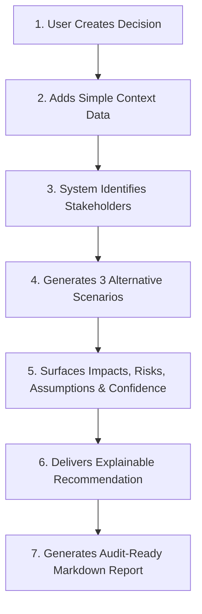

# RippleIQ 🌊🎓

> **Institutional Decision Intelligence for Higher Education**  
> Understand the ripple effects of university leadership decisions before they happen.

[]()
[]()
[]()
[]()
[](LICENSE)

---

## What is RippleIQ?

Universities are complex ecosystems comprising students, faculty, specialized research laboratories, administration, housing, and transit networks. When university leadership contemplates sweeping operational shifts—such as moving from a 5-day to a 4-day on-campus schedule—the second- and third-order consequences can be massive and unanticipated.

**RippleIQ** provides executive-level decision support by analyzing proposed decisions, identifying affected stakeholder groups, simulating alternative scenarios, surfacing critical risks and hidden assumptions, calculating confidence levels, and compiling an explainable, audit-ready Markdown report.

> **Crucial Principle:** RippleIQ is **decision support only**. The system provides structured foresight and risk estimates. The final decision always belongs to a human decision-maker (`human_review_required: true`).

---

## MVP Decision Flow



### Reference Demo Decision
> *"Reduce in-person university attendance from five days to four days per week."*

For this reference decision, RippleIQ identifies 5 core stakeholder groups:
1. **Students** (schedule compression, commuting costs, mental health)
2. **Faculty** (curriculum pacing, office hour load, research flexibility)
3. **Laboratories** (critical biological/chemical continuous experiment disruption)
4. **Administration** (facility utilization, energy costs, scheduling complexity)
5. **Transportation** (shuttle dispatching, parking revenue, traffic congestion)

And generates 3 comparative scenarios:
- **Scenario 1:** Apply the decision as written (immediate 4-day compression)
- **Scenario 2:** Apply a modified version that protects laboratories (laboratory & clinical exemption)
- **Scenario 3:** Run a limited pilot first (single-faculty semester trial)

---

## Repository Structure

```text
ripple-iq/
├── backend/                  # FastAPI backend service
│   ├── app/
│   │   ├── api/              # API routes (/health, /api/v1/decisions, etc.)
│   │   ├── models/           # SQLAlchemy ORM models
│   │   ├── schemas/          # Pydantic v2 schemas
│   │   ├── services/         # Business logic & simulation orchestration
│   │   ├── config.py         # App configuration & environment settings
│   │   ├── database.py       # SQLAlchemy engine & session management
│   │   └── main.py           # Application entrypoint & middleware
│   ├── tests/                # Pytest test suite for API & services
│   ├── alembic/              # Database migration scripts
│   ├── requirements.txt      # Production runtime dependencies
│   ├── requirements-dev.txt  # Testing and linting dependencies
│   ├── .env.example          # Backend environment variables template
│   └── README.md             # Backend architecture & documentation
│
├── ai/                       # Deterministic mock simulation engine
│   ├── mock_analyzer.py      # Core rule-based deterministic analyzer
│   ├── tests/                # Analyzer unit tests
│   └── README.md             # AI analyzer documentation & extension guide
│
├── docs/                     # Architecture & specifications
│   ├── frontend-requirements.md # Comprehensive UI/UX & page specifications
│   ├── backend-requirements.md  # Backend architecture & lifecycle requirements
│   ├── api-contract.md          # Complete REST API specification
│   ├── database.md              # Relational schema & entity documentation
│   └── setup.md                 # Setup, migration, and execution guide
│
├── examples/                 # Sample data & payloads
│   └── university-attendance-decision.json # Reference demo decision payload
│
├── frontend/                 # Existing Next.js frontend application (preserved)
├── docker-compose.yml        # Docker Compose configuration (PostgreSQL + API)
├── CONTRIBUTING.md           # Contribution guidelines
├── SECURITY.md               # Security and human-in-the-loop policy
├── LICENSE                   # MIT License
└── README.md                 # Project README (this file)
```

---

## Technology Stack

- **Backend Framework:** [FastAPI](https://fastapi.tiangolo.com/) (Python 3.11+)
- **Validation & Schemas:** [Pydantic v2](https://docs.pydantic.dev/)
- **ORM & Data Layer:** [SQLAlchemy 2.0](https://www.sqlalchemy.org/)
- **Database Engine:** PostgreSQL 16 (production/docker) & SQLite (zero-config local development)
- **Database Migrations:** [Alembic](https://alembic.sqlalchemy.org/)
- **Analysis Engine:** Deterministic Python Mock Analyzer (`ai/mock_analyzer.py`) — zero API keys or external LLM dependencies required
- **Testing:** [pytest](https://docs.pytest.org/), [HTTPX](https://www.python-httpx.org/)
- **Code Quality:** [Ruff](https://docs.astral.sh/ruff/)

---

## Quickstart Guide

### 1. Local Python Setup

1. **Clone the repository and enter directory:**
   ```bash
   cd ripple-iq/backend
   ```

2. **Create and activate a virtual environment:**
   ```bash
   # Windows PowerShell
   python -m venv .venv
   .venv\Scripts\Activate.ps1

   # macOS / Linux
   python3 -m venv .venv
   source .venv/bin/activate
   ```

3. **Install dependencies:**
   ```bash
   pip install -r requirements.txt
   pip install -r requirements-dev.txt
   ```

4. **Initialize configuration:**
   ```bash
   # Copy sample environment configuration
   cp .env.example .env
   ```
   *(By default, `DATABASE_URL` defaults to `sqlite:///./ripple_iq.db` for instant zero-dependency local running).*

5. **Start the FastAPI server:**
   ```bash
   uvicorn app.main:app --reload --port 8000
   ```

6. **Verify the server:**
   - Interactive Swagger Documentation: [http://localhost:8000/docs](http://localhost:8000/docs)
   - Healthcheck: [http://localhost:8000/health](http://localhost:8000/health)

### 2. Running with Docker Compose

To run RippleIQ with a dedicated PostgreSQL database container:
```bash
docker-compose up --build
```
The API will be available at [http://localhost:8000](http://localhost:8000).

---

## Running Tests

Run the backend and AI test suites:

```bash
# From the backend directory:
pytest -v

# Run AI mock analyzer tests directly:
pytest ai/tests/ -v
```

---

## API Endpoints Overview

| Method | Path | Description |
| :--- | :--- | :--- |
| `GET` | `/health` | System health and uptime |
| `GET` | `/api/v1/health` | API v1 status, environment, and DB readiness |
| `POST` | `/api/v1/decisions` | Create a new university decision |
| `GET` | `/api/v1/decisions/{id}` | Retrieve decision details and status |
| `POST` | `/api/v1/decisions/{id}/context` | Attach institutional context data |
| `POST` | `/api/v1/decisions/{id}/simulate` | Run deterministic multi-scenario simulation |
| `GET` | `/api/v1/decisions/{id}/result` | Retrieve full simulation result and metrics |
| `GET` | `/api/v1/decisions/{id}/report` | Generate and retrieve an audit-ready Markdown report |

Detailed contract documentation is available in [`docs/api-contract.md`](docs/api-contract.md).

---

## Contributing & Governance

Please review:
- [`CONTRIBUTING.md`](CONTRIBUTING.md) for code styling and testing standards.
- [`SECURITY.md`](SECURITY.md) for vulnerability disclosure and safety constraints.

## License

RippleIQ is released under the [MIT License](LICENSE).
