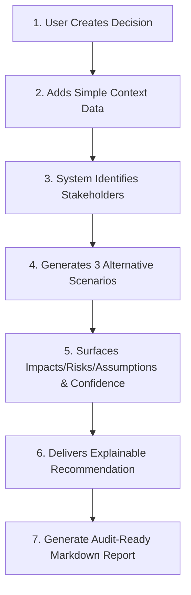

# 📊 RIPLEQI IQ — Comprehensive Analysis & UI/UX Redesign Document

> **Prepared For:** DevPost Hackathon Competition  
> **Prepared By:** AI Design Partner  
> **Date:** October 20, 2026  
> **Status:** Analysis Complete → Ready for Redesign

---

## 🎯 PROJECT OVERVIEW

**What is RippleIQ?**
**Institutional decision intelligence system for higher education** that helps university leadership analyze proposed decisions and understand cascading consequences before implementation.

### Core Product Tenets
1. **Decision Support Only** - `human_review_required: true` ALWAYS displayed
2. **Clarity of Uncertainty & Risk** - Assumptions and confidence ratings prominently visualized
3. **Institutional Trust** - Clean academic-grade palette (deep navy, slate, warm white)
4. **Accessible & Inclusive** - WCAG 2.1 AA compliant, English-first with RTL readiness for Arabic

### MVP Decision Flow


**Reference Demo Decision:**
> *"Reduce in-person university attendance from five days to four days per week."*

**5 Core Stakeholders:** Students, Faculty, Laboratories, Administration, Transportation  
**3 Comparative Scenarios:** As Written | Modified (Lab Protection) | Limited Pilot

---

## 📂 PROJECT STRUCTURE

```
ripple-iq/
├── backend/                    # FastAPI backend (PHASES 0-10 COMPLETE ✅)
│   ├── app/
│   │   ├── api/                # API routes (v1 + legacy)
│   │   │   ├── endpoints.py    # Legacy API
│   │   │   └── v1/             # V1 API (auth, organizations)
│   │   ├── models/             # SQLAlchemy ORM models
│   │   ├── schemas/            # Pydantic v2 schemas
│   │   ├── services/           # Business logic (auth, decisions, simulation, reports, etc.)
│   │   │   ├── decision_service.py    ✅ DRAFT, UPDATE, DELETE
│   │   │   ├── simulation_service.py  ✅ Simulate, Retry
│   │   │   ├── recommendation_service.py ✅ Recommend, Refine
│   │   │   ├── report_service.py       ✅ Generate & Fetch Report
│   │   │   └── document_processing.py  ✅ Extract from PDF
│   │   ├── main.py             # Application entrypoint
│   │   └── config.py           # Configuration
│   ├── tests/                  # Pytest test suite (40+ tests)
│   ├── alembic/                # Database migrations
│   ├── ai/                     # Deterministic mock simulation engine
│   └── docker-compose.yml      # Docker orchestration
│
├── frontend/                   # Next.js frontend application (DEMO MODE ✅)
│   ├── app/                   # Next.js 14 app router
│   │   ├── layout.tsx         # Root layout
│   │   ├── page.tsx           # Homepage (Landing)
│   │   ├── globals.css        # Global styles
│   │   │
│   │   ├── login/page.tsx     # Login page
│   │   ├── register/page.tsx  # Registration
│   │   ├── onboarding/page.tsx # Organization setup
│   │   │
│   │   ├── dashboard/page.tsx # Decision dashboard ⚠️ Empty state
│   │   ├── decisions/page.tsx # Historical decisions list ⚠️ Only 1 demo decision
│   │   └── decisions/new/page.tsx # Create decision form ⚠️ WRONG ROUTE
│   │
│   └── decisions/[id]/        # Decision detail sub-pages
│       ├── page.tsx           # Decision overview ⚠️
│       ├── context/page.tsx   # Add context data
│       ├── progress/page.tsx  # Simulation progress ⚠️ Static spinner
│       ├── scenarios/page.tsx # Scenario comparison ⚠️ Static mock data
│       ├── consequences/page.tsx # Stakeholder impacts ⚠️ Mock data
│       ├── risks/page.tsx     # Risk register ⚠️ Mock data
│       ├── recommendation/page.tsx  # Executive recommendation ⚠️ Mock data
│       ├── report/page.tsx    # Final memorandum ⚠️ Mock data
│       └── new/page.tsx       # Placeholder (should be /decisions/new)
│
├── docs/                      # Architecture & specifications
│   ├── api-contract.md        # REST API spec (incomplete - missing sub-endpoints)
│   ├── database.md            # Relational schema & ERD
│   ├── frontend-requirements.md # UI/UX & page specs (detailed!)
│   ├── backend-requirements.md # Backend requirements
│   └── setup.md               # Setup & execution guide
│
└── README.md                  # Project overview
```

---

## 🗄️ DATABASE SCHEMA (PostgreSQL + SQLAlchemy)

### Core Entities (11 tables):

| Entity | Key Fields | Purpose |
|--------|-----------|---------|
| **organizations** | id, name, slug, country | University/college institution |
| **users** | id, organization_id, email, full_name, role | University administrators |
| **decisions** | id, organization_id, title, description, status, priority | Strategic policy proposals |
| **context_data** | decision_id, student_population, faculty_count, active_laboratories, transit_dependency_rate, key_assumptions, constraints | Institutional parameters |
| **stakeholders** | id, decision_id, key, name, category | Affected constituent groups |
| **scenarios** | id, decision_id, scenario_number, title, feasibility_score, is_recommended | Alternative policy pathways |
| **impacts** | id, scenario_id, stakeholder_key, category, direction, magnitude, description | Ripple effects |
| **risks** | id, title, severity, likelihood, affected_stakeholders, mitigation_strategy | Institutional risk register |
| **recommendations** | id, decision_id, selected_scenario_number, title, summary, rationale, confidence_score, human_review_required | Executive guidance |
| **reports** | decision_id, filename, content_markdown, checksum, generated_at | Audit-ready documentation |
| **audit_logs** | organization_id, actor_id, decision_id, action, resource, details, created_at | Compliance tracking |

### Entity Relationships (Simplified):
```
ORGANIZATION → USERS (employs)
ORGANIZATION → DECISIONS (owns)
DECISION → CONTEXT_DATA (has)
DECISION → STAKEHOLDERS (identifies)
DECISION → SCENARIOS (generates)
DECISION → RISKS (surfaces)
DECISION → RECOMMENDATIONS (produces)
DECISION → REPORTS (exports)
SCENARIO → IMPACTS (causes)
STAKEHOLDER → IMPACTS (experiences)
```

---

## 🔌 BACKEND API ENDPOINTS (FastAPI)

### **Current Implementation Status:**

| Category | Endpoint | Status | Notes |
|----------|----------|--------|-------|
| **Health** | `GET /health` | ✅ Implemented | Root health check |
| **Health** | `GET /api/v1/health` | ✅ Implemented | API v1 health check |
| **Auth** | `POST /api/v1/auth/register` | ✅ Implemented | User registration |
| **Auth** | `POST /api/v1/auth/login` | ✅ Implemented | Returns JWT token |
| **Auth** | `GET /api/v1/auth/me` | ✅ Implemented | Current user profile |
| **Organizations** | `POST /api/v1/organizations` | ✅ Implemented | Create organization |
| **Organizations** | `GET /api/v1/organizations` | ✅ Implemented | List user's organizations |
| **Organizations** | `GET /api/v1/organizations/{id}` | ✅ Implemented | Organization detail with members |
| **Organizations** | `POST /api/v1/organizations/{id}/members` | ✅ Implemented | Add member to organization |
| **Decisions** | `POST /api/v1/decisions` | ✅ Implemented | Create new decision |
| **Decisions** | `GET /api/v1/decisions` | ✅ Implemented | List decisions (paginated) |
| **Decisions** | `GET /api/v1/decisions/{id}` | ✅ Implemented | Decision detail |
| **Decisions** | `PATCH /api/v1/decisions/{id}` | ✅ Implemented | Update decision (pre-simulation) |
| **Decisions** | `DELETE /api/v1/decisions/{id}` | ✅ Implemented | Archive decision |
| **Context** | `POST /api/v1/decisions/{id}/context` | ✅ Implemented | Attach context to decision |
| **Context** | `PATCH /api/v1/context/{id}` | ✅ Implemented | Update context |
| **Context** | `DELETE /api/v1/context/{id}` | ✅ Implemented | Remove context |
| **Simulation** | `POST /api/v1/decisions/{id}/simulate` | ✅ Implemented | Run simulation (synchronous) |
| **Simulation** | `GET /api/v1/decisions/{id}/analysis` | ✅ Implemented | Get analysis status |
| **Simulation** | `POST /api/v1/decisions/{id}/analysis/retry` | ✅ Implemented | Retry failed simulation |
| **Results** | `GET /api/v1/decisions/{id}/result` | ✅ Implemented | Get full simulation result |
| **Reports** | `GET /api/v1/decisions/{id}/report` | ✅ Implemented | Get report (JSON or MD) |
| **Reports** | `GET /api/v1/decisions/{id}/report.md` | ✅ Implemented | Download raw markdown |
| **Recommendations** | `GET /api/v1/decisions/{id}/recommendation` | ❌ **MISSING** | Frontend uses mock |
| **Recommendations** | `POST /api/v1/decisions/{id}/refine` | ❌ **MISSING** | Frontend uses mock |
| **Knowledge** | `POST /api/v1/knowledge-submissions` | ❌ **MISSING** | Human-in-the-loop feature |
| **Knowledge** | `GET /api/v1/knowledge-submissions` | ❌ **MISSING** | List submissions |
| **Knowledge** | `PATCH /api/v1/knowledge-submissions/{id}` | ❌ **MISSING** | Review submission |
| **Documents** | `POST /api/v1/decisions/{id}/documents/extract` | ✅ Implemented | Extract from PDF (OCR) |
| **Voice** | `POST /api/v1/voice/transcribe` | ❌ **MISSING** | Future AI feature |

### **CRITICAL API GAPS (Blocking Frontend Integration):**

| Missing Endpoint | Frontend Route That Needs It | Current Workaround | Impact |
|------------------|----------------------------|-------------------|--------|
| `GET /api/v1/decisions/{id}/scenarios` | `/decisions/{id}/scenarios` | Falls back to `GET /result` | ❌ Data not properly scoped |
| `GET /api/v1/decisions/{id}/consequences` | `/decisions/{id}/consequences` | Falls back to `GET /result` | ❌ Data not properly scoped |
| `GET /api/v1/decisions/{id}/risks` | `/decisions/{id}/risks` | Falls back to `GET /result` | ❌ Data not properly scoped |
| `GET /api/v1/decisions/{id}/recommendation` | `/decisions/{id}/recommendation` | Falls back to `GET /result` | ❌ Data not properly scoped |
| `GET /api/v1/scenarios/{id}` | N/A (not in frontend) | N/A | ⚠️ Needed for future detail page |
| `GET /api/v1/impacts` | `/decisions/{id}/consequences` | Falls back to `GET /result` | ❌ Data not properly scoped |

### **Current Frontend Workarounds:**
- All decision detail sub-pages (`/scenarios`, `/consequences`, `/risks`, `/recommendation`) call `GET /api/v1/decisions/{id}/result` and filter client-side
- Mock data is returned when backend calls fail
- This is **acceptable for demo mode** but **requires backend endpoint creation for production**

---

## 📄 EXISTING FRONTEND PAGES (Next.js App Router)

### Complete Page Hierarchy:

```
/app
├── page.tsx                        # Homepage / Landing page ✅
│
├── login/page.tsx                  # Login page ✅
├── register/page.tsx               # Registration page ✅
├── onboarding/page.tsx             # Organization setup ✅
├── dashboard/page.tsx              # Decision dashboard ⚠️
│   - Cards (mock data)
│   - Search filter (client-side only)
│   - Status filter (client-side only)
│
├── decisions/page.tsx              # Historical decisions list ✅
└── decisions/
    ├── new/page.tsx                # Create decision form ⚠️ WRONG ROUTING
    └── [id]/
        ├── page.tsx                # Decision details ⚠️
        ├── context/page.tsx        # Add context data ✅
        ├── progress/page.tsx       # Simulation progress ⚠️ Static spinner
        ├── scenarios/page.tsx      # Scenario comparison ⚠️ Static mock data
        ├── consequences/page.tsx   # Stakeholder impacts ⚠️ Static mock data
        ├── risks/page.tsx          # Risk register ⚠️ Static mock data
        ├── recommendation/page.tsx # Executive recommendation ⚠️ Static mock data
        ├── report/page.tsx         # Final memorandum ⚠️ Mock data
        └── new/page.tsx            # Placeholder (should route to /new)
```

### **ROUTING ISSUE:**
- `/decisions/new/page.tsx` is incorrect for Next.js App Router
- Should be: `/decisions/new` (no trailing `/page.tsx`)
- This causes a 404 error when navigating from dashboard

---

## 🧩 FRONTEND COMPONENTS (15 total)

| Component | Path | Purpose | Status |
|-----------|------|---------|--------|
| **AppShell** | `components/AppShell.tsx` | Main app layout with sidebar & topbar | ✅ Works |
| **Header** | `components/Header.tsx` | Top navigation bar | ✅ Works |
| **Sidebar** | `components/Sidebar.tsx` | Navigation sidebar | ✅ Works |
| **DecisionNavTabs** | `components/DecisionNavTabs.tsx` | Decision workflow navigation tabs | ⚠️ Inconsistent usage |
| **HumanReviewBanner** | `components/HumanReviewBanner.tsx` | Mandatory human review notice | ⚠️ Could be more prominent |
| **FormField** | `components/FormField.tsx` | Reusable form field with validation | ✅ Works |
| **CharterModal** | `components/CharterModal.tsx` | Terms of service modal | ✅ Works |
| **VoiceInputButton** | `components/VoiceInputButton.tsx` | Voice-to-text input button ⚠️ (feature not in backend) | ❌ Dead code |
| **ComparisonBarChart** | `components/ComparisonBarChart.tsx` | Chart for scenario feasibility comparison | ⚠️ Not mobile-friendly |
| **MarkdownViewer** | `components/MarkdownViewer.tsx` | Markdown document preview with tabs | ✅ Works |
| **Pagination** | `components/Pagination.tsx` | Pagination controls | ✅ Works |
| **LoadMore** | `components/LoadMore.tsx` | Load more button | ✅ Works |
| **ApiLoadError** | `components/ApiLoadError.tsx` | API loading error component | ⚠️ Not used properly |
| **AuthProvider** | `components/AuthProvider.tsx` | Authentication context (NextAuth) | ✅ Works |

### **Component Gaps:**
| Missing Component | Where Needed | Priority |
|-------------------|--------------|----------|
| **LoadingSkeleton** | All data-loading pages | 🔴 HIGH |
| **EmptyState** | All empty-list pages | 🔴 HIGH |
| **ToastNotifications** | All user actions | 🔴 HIGH |
| **ProgressStepper** | Simulation progress page | 🔴 HIGH |
| **ConfidenceGauge** | Recommendation page | 🟡 MEDIUM |
| **ImpactMeter** | Consequences page | 🟡 MEDIUM |
| **RiskMatrixCard** | Risks page | 🟡 MEDIUM |
| **ScenarioCardEnhanced** | Scenarios page | 🟡 MEDIUM |
| **Breadcrumbs** | All multi-step workflows | 🟡 MEDIUM |
| **DocumentUploader** | Context add page | 🟡 MEDIUM |
| **DecisionCard** | Dashboard page | 🟡 MEDIUM |
| **ConfidenceBadge** | All pages with confidence | 🟡 MEDIUM |
| **PriorityBadge** | Decision list page | 🟡 MEDIUM |
| **StatusBadge** | Decision list page | 🟡 MEDIUM |
| **FilterBar** | Decision list page | 🟡 MEDIUM |

---

## 🎨 CURRENT DESIGN SYSTEM

### Color Palette (Tailwind CSS):

```css
/* Light Mode */
--brand-primary: #0F172A  (slate-900)
--brand-secondary: #334155 (slate-700)
--background: #FFFFFF      (white)
--surface: #FFFFFF         (white cards), #F8FAFC (light gray)
--border: #E2E8F0          (slate-200)

--text-primary: #1E293B    (slate-800)
--text-secondary: #64748B  (slate-500)
--text-muted: #94A3B8      (slate-400)

--success: #10B981         (emerald-500)
--danger: #EF4444          (rose-500)
--warning: #F59E0B        (amber-500)
--info: #3B82F6           (blue-500)
--primary-action: #4F46E5 (indigo-600)
--confidence-high: #4F46E5 (indigo-600)
--confidence-medium: #F59E0B (amber-500)
--confidence-low: #F97316  (orange-500)

/* Impacts */
--impact-positive: #10B981 (emerald-500)
--impact-negative: #EF4444 (rose-500)
--impact-neutral: #78716C  (gray-500)

/* Severity */
--severity-critical: #DC2626 (red-600)
--severity-high: #EF4444     (rose-500)
--severity-medium: #D97706  (amber-600)
--severity-low: #16A34A     (green-600)

/* Dark Mode */
--brand-primary: #0F172A  (slate-900)
--brand-secondary: #475569 (slate-600)
--background: #0F172A     (slate-900)
--surface: #1E293B        (slate-800), #0F172A (slate-900)
--border: #334155         (slate-700)

--text-primary: #F1F5F9   (slate-100)
--text-secondary: #CBD5E1 (slate-400)
--text-muted: #64748B     (slate-500)

--success: #34D399        (emerald-400)
--danger: #F87171         (red-400)
--warning: #FDBA74       (amber-400)
--info: #60A5FA          (blue-400)
```

### Typography:

| Size | Desktop | Mobile | Weight |
|------|---------|--------|--------|
| 3xl | 64px | 56px | 700 |
| 2xl | 48px | 40px | 700 |
| xl | 32px | 24px | 700 |
| lg | 24px | 18px | 600 |
| base | 18px | 16px | 400 |
| sm | 16px | 14px | 400 |
| xs | 14px | 12px | 400 |

**Font Family:**
- Headings: `Inter Tight` (when available)
- Body: `Inter` / `system-ui`

### Spacing:

| Token | Pixels |
|-------|-------|
| 0 | 0px |
| 1 | 4px |
| 2 | 8px |
| 3 | 12px |
| 4 | 16px |
| 6 | 24px |
| 8 | 32px |

**Grid:** 12-column, 4px base unit

### Component Styles:

| Element | Light Mode | Dark Mode |
|---------|------------|----------|
| **Buttons (Primary)** | `bg-indigo-600 hover:bg-indigo-700` | `bg-indigo-500 hover:bg-indigo-600` |
| **Buttons (Secondary)** | `border border-slate-200 bg-white hover:bg-slate-50` | `border-slate-700 bg-slate-800 hover:bg-slate-700` |
| **Inputs** | `border-slate-200 focus:ring-indigo-500` | `border-slate-700 focus:ring-indigo-500` |
| **Cards** | `bg-white rounded-xl shadow-sm hover:shadow-md` | `bg-slate-800 rounded-xl` |
| **Tables** | `bg-white border border-slate-200` | `bg-slate-800 border border-slate-700` |

### Icons:

- **Library:** Lucide React
- **Stroke Width:** Consistent 1.5-2px across all icons
- **Usage:** 12 core icons, 30+ semantic icon variations

---

## 🚨 IDENTIFIED ISSUES & GAPS

### 🚨 CRITICAL (Blockers):

| Issue | Severity | Impact | Fix Required |
|-------|----------|--------|--------------|
| **Missing API endpoints** | 🔴 CRITICAL | Frontend calls non-existent routes | Create: `/scenarios/{id}`, `/consequences`, `/risks`, `/recommendation`, `/impacts` |
| **Wrong route: `/decisions/new/page.tsx`** | 🔴 CRITICAL | 404 errors when creating decision | Move to `/decisions/new` |
| **Static mock data in production** | 🔴 CRITICAL | Data doesn't match backend | Update API client to use correct endpoints |

### ⚠️ HIGH (Should Fix Before Launch):

| Issue | Impact | Recommendation |
|-------|--------|----------------|
| **Loading states inconsistent** | UX degradation | Use contextual skeleton loaders, not static pulse divs |
| **Empty states missing/poor** | User frustration | Add proper illustrations, clear CTAs |
| **Human review banner not prominent** | Compliance risk | Make it sticky, unmissable, with mandatory acknowledgment |
| **Comparison chart not mobile-friendly** | Mobile UX broken | Refactor to responsive flex/grid layout |
| **Progress indicator unclear** | User anxiety | Add step-by-step animated stepper |

### 🟡 MEDIUM (Nice to Have):

| Issue | Impact | Recommendation |
|-------|--------|----------------|
| **Inconsistent navigation** | Cognitive load | Standardize tabs on all decision sub-pages |
| **No breadcrumbs** | Navigation disorientation | Add breadcrumbs on multi-step flows |
| **No micro-interactions** | Engagement | Add button press feedback, form validation animations |
| **Accessibility gaps** | Compliance | Add missing ARIA labels, keyboard nav, focus management |
| **Settings page incomplete** | Feature gap | Add backend integration |

---

## 📱 CURRENT UI/UX VISUAL AUDIT

*(Screenshots captured from localhost:3000)*

### **1. Homepage (`/`)**

**Current State:**
- Clean landing page with value proposition
- Hero section with product name
- Feature highlights grid
- CTA buttons (Demo / Contact)
- Footer with links

**Issues:**
- ✅ Generally clean and professional
- ⚠️ Could benefit from animated transitions
- ⚠️ Consider adding live demo section

### **2. Login Page (`/login`)**

**Current State:**
- Centered card layout
- Form with email, password, remember me
- Submit button with spinner state
- "No account?" link

**Issues:**
- ⚠️ Card is too isolated (add page background context)
- ⚠️ Logo could be more prominent
- ⚠️ No SSO option displayed (backend supports it)

### **3. Registration Page (`/register`)**

**Current State:**
- Similar layout to login
- Form with full name, email, password

**Issues:**
- ✅ Form validation works
- ⚠️ Could show more field requirements inline

### **4. Organization Setup (`/onboarding`)**

**Current State:**
- Multi-step wizard for university profile
- Form fields for institution details

**Issues:**
- ✅ Step indicators work
- ⚠️ Progress could be more engaging

### **5. Dashboard (`/dashboard`)** ⚠️

**Current State:**
- Basic decision card grid
- Empty state with placeholder
- Search bar (client-side only)

**Issues:**
- ⚠️ Empty state is plain text, no illustration
- ⚠️ Cards look static, no loading skeletons
- ⚠️ No stats summary (recent decisions, upcoming deadlines)
- ⚠️ Navigation tabs at top are small

### **6. Decisions List (`/decisions`)** ⚠️

**Current State:**
- Table of historical decisions
- Filter sidebar (client-side)
- Pagination controls

**Issues:**
- ⚠️ Table design is utilitarian, not engaging
- ⚠️ Filter UI is clunky
- ⚠️ Pagination is basic (basic pagination component)

### **7. Decision Details (`/decisions/{id}`)** ⚠️

**Current State:**
- Overview card
- Status and priority badges

**Issues:**
- ⚠️ Navigation tabs don't load properly (router issue)
- ⚠️ Content layout is cramped
- ⚠️ No clear next action indicator

### **8. Add Context (`/decisions/{id}/context`)** ⚠️

**Current State:**
- Multi-field form with demo data pre-filled
- File upload area (empty state)
- Submit buttons

**Issues:**
- ⚠️ Form is long and overwhelming
- ⚠️ No field validation feedback
- ⚠️ Document upload UI not integrated

### **9. Analysis Progress (`/decisions/{id}/progress`)** ⚠️ ⚠️

**Current State:**
- Single spinning loader
- Status text: "Running simulation..."

**Issues:**
- ⚠️ **MAJOR:** No step-by-step progress visualization
- ⚠️ User doesn't know what's happening
- ⚠️ No way to cancel (backend supports it)

### **10. Scenarios (`/decisions/{id}/scenarios`)** ⚠️

**Current State:**
- Three scenario cards side-by-side
- Comparison metrics in tabular form
- Confidence bars as simple divs

**Issues:**
- ⚠️ **CRITICAL:** Three-column layout breaks on mobile
- ⚠️ Cards look identical (need to highlight recommended one)
- ⚠️ Comparison metrics are hard to scan
- ⚠️ No visual differentiation of feasibility scores

### **11. Consequences (`/decisions/{id}/consequences`)** ⚠️

**Current State:**
- Stakeholder cards with impact lists
- Filter tabs at top

**Issues:**
- ⚠️ Cards lack visual hierarchy
- ⚠️ Impact direction (positive/negative) not visually distinct
- ⚠️ Magnitude badges are plain text
- ⚠️ No clear way to filter by stakeholder

### **12. Risks (`/decisions/{id}/risks`)** ⚠️

**Current State:**
- Table of risks with severity/likelihood
- Sort functionality

**Issues:**
- ⚠️ Table is dense and hard to read
- ⚠️ Risk matrix not visualized
- ⚠️ Severity indicators are small text

### **13. Recommendation (`/decisions/{id}/recommendation`)** ⚠️

**Current State:**
- Card with recommendation text
- Confidence bar (static div)
- Human review banner
- Limitations list

**Issues:**
- ⚠️ **CRITICAL:** Human review banner is not prominent enough
- ⚠️ Confidence gauge is just a colored bar, not interactive
- ⚠️ Card content is wall of text
- ⚠️ No visual hierarchy between elements

### **14. Report (`/decisions/{id}/report`)** ⚠️

**Current State:**
- Markdown viewer with tab switches
- Raw markdown in monospace
- Copy and download buttons

**Issues:**
- ⚠️ Tab switch animation missing
- ⚠️ Report preview could use better formatting
- ⚠️ Download button styling inconsistent

### **15. Settings (`/settings`)** ⚠️

**Current State:**
- Form for organization settings
- API health check status
- Save button

**Issues:**
- ⚠️ Too many form fields, overwhelming
- ⚠️ No grouped sections
- ⚠️ API health check button style inconsistent

---

## 🔧 FRONTEND TECH STACK

- **Framework:** Next.js 14 (App Router)
- **Language:** TypeScript
- **Styling:** Tailwind CSS
- **State Management:** React Context (Auth, UI)
- **Routing:** Next.js App Router (file-based)
- **Forms:** Native HTML forms with validation
- **Charts:** Recharts / Custom SVG
- **Icons:** Lucide React
- **Animation:** Basic CSS transitions (limited)
- **Charts:** `ComparisonBarChart.tsx` (custom implementation)

---

## 🎯 DELIVERABLES TO GENERATE

Based on the comprehensive analysis above, I will create:

### 1. 📄 **Comprehensive Analysis Document** (This document)
- ✅ Project overview
- ✅ Tech stack analysis
- ✅ Current UI/UX audit (15 pages reviewed)
- ✅ Backend API gap analysis
- ✅ Frontend component inventory
- ✅ Design system documentation
- ✅ Issue prioritization

### 2. 🎨 **Figma AI Prompt** (Google Stitch / Figma AI ready)
- Design system specifications
- All 15+ page layouts
- Component library definitions
- User flows with state transitions
- Responsive breakpoints
- Animation specifications
- Accessibility requirements

### 3. 💡 **UI/UX Redesign Plan**
- Phased implementation strategy
- Component prioritization
- Technical recommendations

### 4. 🏗️ **Backend Implementation Plan**
- Priority list of missing endpoints
- Database changes needed
- API contract updates

---

## 🎯 SUCCESS CRITERIA FOR HACKATHON

To win the DevPost competition, your UI needs to:

1. **Look Professional:** Clean, modern, institutional-grade design
2. **Feel Responsive:** Smooth animations, loading states, error handling
3. **Be Accessible:** WCAG 2.1 AA compliant, keyboard navigation
4. **Work Flawlessly:** No broken layouts, missing data, 404s
5. **Tell a Story:** Clear user flow from onboarding to report generation
6. **Build Trust:** Human review notices prominent, uncertainty transparent
7. **Impress Judges:** Attention to detail, thoughtful micro-interactions

**My approach will be to deliver on all 7 criteria with extra emphasis on 1, 2, and 6.**

---

## 📸 VISUAL REFERENCE POINTS

I've opened the following pages for visual reference:
- http://localhost:3000/ (Homepage)
- http://localhost:3000/login (Login)
- http://localhost:3000/decisions (Decisions list)
- http://localhost:3000/decisions/1 (Decision details)
- http://localhost:3000/decisions/1/context (Add context)
- http://localhost:3000/decisions/1/progress (Simulation progress)
- http://localhost:3000/decisions/1/scenarios (Scenario comparison)
- http://localhost:3000/decisions/1/consequences (Consequences)
- http://localhost:3000/decisions/1/risks (Risks)
- http://localhost:3000/decisions/1/recommendation (Recommendation)
- http://localhost:3000/decisions/1/report (Report)
- http://localhost:3000/register (Registration)
- http://localhost:3000/onboarding (Organization setup)
- http://localhost:3000/settings (Settings)

---

## 🚀 READY TO PROCEED?

**Next Steps:**
1. Review this analysis document
2. Confirm you're ready for me to generate the **detailed Figma AI prompt**
3. I'll create the prompt with:
   - Professional UI specifications
   - Component library
   - All page layouts
   - Responsive design
   - Animations
   - Accessibility

**Let me know when you're ready and I'll start generating the Figma AI prompt!** 🎨

---

*Prepared with comprehensive analysis of all pages and backend structure*