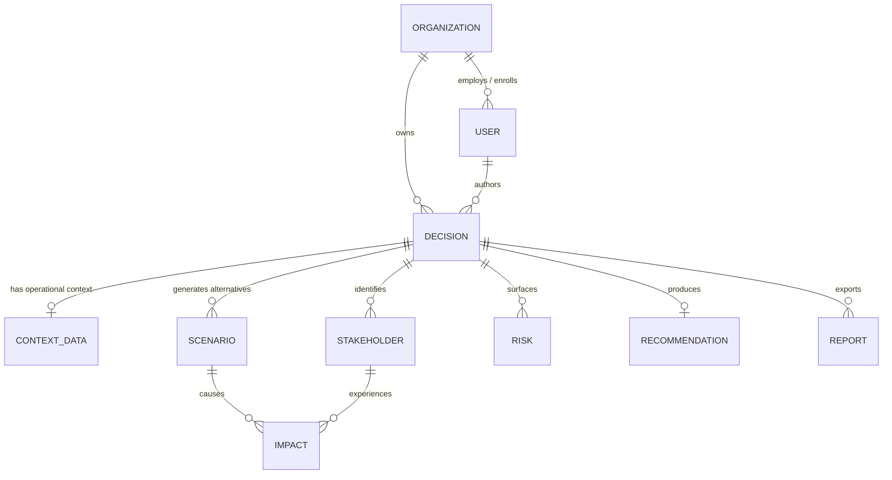

# RippleIQ — Database Schema Specification

> **Document Version:** 1.0.0 (MVP)  
> **Database Engine:** PostgreSQL 16 (Production) / SQLite 3 (Local Development & Testing)  
> **ORM Layer:** SQLAlchemy 2.0 (Declarative Mapping)  
> **Migration Tool:** Alembic

---

## Implemented relational schema

The ORM uses SQLAlchemy 2-compatible declarative models with integer primary
keys, UTC timestamps, JSON fields for structured details, and explicit foreign
key delete behavior. The existing `backend/alembic/` layout is retained. The
original repository revision was empty; the next migration creates the complete
current base schema on a clean database. PostgreSQL is the application default,
while tests use an isolated in-memory SQLite database.

Implemented entities are `organizations`, `users`, `organization_members`,
`decisions`, `context_data`, `stakeholders`, `scenarios`, `impacts`, `risks`,
`recommendations`, `reports`, and `audit_logs`. Membership rows are unique per
organization/user pair and constrain role values to `owner`, `admin`,
`decision_maker`, `reviewer`, or `viewer`. Audit logs retain the organization,
actor, and decision references when available, plus an action, resource, JSON
details, and creation timestamp.
The `users.password_hash` column stores Argon2 hashes only; it is nullable to
leave any legacy account without a credential unable to authenticate.

Run `alembic upgrade head` against a new PostgreSQL database before starting the
API. The app no longer creates database tables implicitly during startup.
Databases previously created by the old development `create_all` startup path
have no Alembic revision marker; do not run the clean-database migration against
those databases without first backing them up and planning a schema baseline.
The current Neon PostgreSQL branch is at Alembic revision `ec7bfb230dc3`; its
connection string is supplied at runtime through `DATABASE_URL`, never stored
in the repository. The same setting can later point at a private PostgreSQL
endpoint in the VPC when the backend moves to a local server.

## 1. Entity Relationship Diagram (ERD)



---

## 2. Entity Specifications

### 2.1 `organizations`
Represents the higher education institution (university, college, or university system).

| Column | Type | Constraints | Description |
| :--- | :--- | :--- | :--- |
| `id` | `INTEGER` | Primary Key, Auto-increment | Unique identifier |
| `name` | `VARCHAR(255)` | Not Null, Unique | Institution name (e.g., Al-Mustaqbal University) |
| `slug` | `VARCHAR(100)` | Not Null, Unique, Indexed | URL/lookup friendly identifier |
| `country` | `VARCHAR(100)` | Nullable | Country of operation |
| `created_at` | `TIMESTAMP WITH TIME ZONE` | Default UTC now | Registration timestamp |
| `updated_at` | `TIMESTAMP WITH TIME ZONE` | Default UTC now | Last update timestamp |

---

### 2.2 `users`
University administrators, provosts, deans, and institutional analysts.

| Column | Type | Constraints | Description |
| :--- | :--- | :--- | :--- |
| `id` | `INTEGER` | Primary Key, Auto-increment | Unique user identifier |
| `organization_id` | `INTEGER` | Foreign Key (`organizations.id`), Not Null | Associated university |
| `email` | `VARCHAR(255)` | Not Null, Unique, Indexed | Institutional email address |
| `full_name` | `VARCHAR(255)` | Not Null | User full name |
| `role` | `VARCHAR(50)` | Not Null, Default `'ADMIN'` | Role (`ADMIN`, `ANALYST`, `VIEWER`) |
| `is_active` | `BOOLEAN` | Not Null, Default `TRUE` | Account status |
| `created_at` | `TIMESTAMP WITH TIME ZONE` | Default UTC now | Creation timestamp |

---

### 2.3 `decisions`
The strategic university administrative policy or decision under evaluation.

| Column | Type | Constraints | Description |
| :--- | :--- | :--- | :--- |
| `id` | `INTEGER` | Primary Key, Auto-increment | Unique decision identifier |
| `organization_id` | `INTEGER` | Foreign Key (`organizations.id`), Nullable | Owning institution |
| `created_by_user_id`| `INTEGER` | Foreign Key (`users.id`), Nullable | User who created decision |
| `title` | `VARCHAR(500)` | Not Null | Core decision proposition |
| `description` | `TEXT` | Not Null | Full narrative and operational scope |
| `department` | `VARCHAR(255)` | Nullable | Governing department / college |
| `time_horizon` | `VARCHAR(100)` | Nullable | e.g. "1 Academic Year" |
| `priority` | `VARCHAR(50)` | Default `'HIGH'` | Priority level |
| `status` | `VARCHAR(50)` | Default `'DRAFT'` | `DRAFT`, `SIMULATED`, `ARCHIVED` |
| `created_at` | `TIMESTAMP WITH TIME ZONE` | Default UTC now | Creation timestamp |
| `updated_at` | `TIMESTAMP WITH TIME ZONE` | Default UTC now | Last update timestamp |

---

### 2.4 `context_data`
Structured institutional parameters attached to a decision.

| Column | Type | Constraints | Description |
| :--- | :--- | :--- | :--- |
| `id` | `INTEGER` | Primary Key, Auto-increment | Unique context identifier |
| `decision_id` | `INTEGER` | Foreign Key (`decisions.id`), Unique, Not Null | Associated decision |
| `student_population`| `INTEGER` | Nullable | Total student enrollment |
| `faculty_count` | `INTEGER` | Nullable | Total faculty members |
| `active_laboratories`| `INTEGER`| Nullable | Continuous wet/dry research labs |
| `transit_dependency_rate` | `FLOAT` | Nullable | Percentage using transit (0.0-100.0) |
| `key_assumptions` | `JSON` | Default `'[]'` | List of explicit assumptions |
| `constraints` | `TEXT` | Nullable | Accreditation, statutory, or union bounds |
| `raw_metadata` | `JSON` | Default `'{}'` | Extensible key-value metadata |
| `created_at` | `TIMESTAMP WITH TIME ZONE` | Default UTC now | Creation timestamp |

---

### 2.5 `stakeholders`
Identified constituent groups impacted by the decision.

| Column | Type | Constraints | Description |
| :--- | :--- | :--- | :--- |
| `id` | `INTEGER` | Primary Key, Auto-increment | Unique identifier |
| `decision_id` | `INTEGER` | Foreign Key (`decisions.id`), Not Null | Associated decision |
| `key` | `VARCHAR(100)` | Not Null | Slug identifier (`students`, `laboratories`, etc.) |
| `name` | `VARCHAR(255)` | Not Null | Human-readable title |
| `category` | `VARCHAR(100)` | Not Null | `ACADEMIC`, `OPERATIONAL`, `COMMUNITY` |
| `summary` | `TEXT` | Nullable | Summary of why group is impacted |

---

### 2.6 `scenarios`
Alternative policy execution pathways generated by the simulation engine.

| Column | Type | Constraints | Description |
| :--- | :--- | :--- | :--- |
| `id` | `INTEGER` | Primary Key, Auto-increment | Unique identifier |
| `decision_id` | `INTEGER` | Foreign Key (`decisions.id`), Not Null | Associated decision |
| `scenario_number` | `INTEGER` | Not Null | Sequence (1, 2, or 3) |
| `title` | `VARCHAR(255)` | Not Null | Scenario title |
| `description` | `TEXT` | Not Null | Operational mechanics |
| `feasibility_score`| `FLOAT` | Not Null | 0.00 to 1.00 feasibility estimate |
| `is_recommended` | `BOOLEAN` | Default `FALSE` | Indicates winning recommendation |
| `tradeoff_summary` | `TEXT` | Nullable | High-level trade-off synthesis |

---

### 2.7 `impacts`
Specific first-, second-, and third-order ripples observed per scenario and stakeholder.

| Column | Type | Constraints | Description |
| :--- | :--- | :--- | :--- |
| `id` | `INTEGER` | Primary Key, Auto-increment | Unique identifier |
| `scenario_id` | `INTEGER` | Foreign Key (`scenarios.id`), Not Null | Linked scenario |
| `stakeholder_key`| `VARCHAR(100)` | Not Null | Linked stakeholder slug |
| `category` | `VARCHAR(100)` | Not Null | `FINANCIAL`, `ACADEMIC`, `LOGISTICS`, etc. |
| `direction` | `VARCHAR(50)` | Not Null | `POSITIVE`, `NEGATIVE`, `NEUTRAL` |
| `magnitude` | `VARCHAR(50)` | Not Null | `LOW`, `MEDIUM`, `HIGH` |
| `description` | `TEXT` | Not Null | Impact description |
| `metric_estimate` | `VARCHAR(255)` | Nullable | Quantified projection (e.g. "20% cost cut") |

---

### 2.8 `risks`
Institutional failure modes, liabilities, and potential negative disruptions.

| Column | Type | Constraints | Description |
| :--- | :--- | :--- | :--- |
| `id` | `INTEGER` | Primary Key, Auto-increment | Unique identifier |
| `decision_id` | `INTEGER` | Foreign Key (`decisions.id`), Not Null | Associated decision |
| `title` | `VARCHAR(255)` | Not Null | Risk summary |
| `severity` | `VARCHAR(50)` | Not Null | `CRITICAL`, `HIGH`, `MEDIUM`, `LOW` |
| `likelihood` | `VARCHAR(50)` | Not Null | `HIGH`, `MEDIUM`, `LOW` |
| `affected_stakeholders` | `JSON` | Default `'[]'` | List of affected stakeholder keys |
| `mitigation_strategy` | `TEXT` | Not Null | Concrete mitigation guidance |

---

### 2.9 `recommendations`
Explainable executive recommendation synthesizing the simulation output.

| Column | Type | Constraints | Description |
| :--- | :--- | :--- | :--- |
| `id` | `INTEGER` | Primary Key, Auto-increment | Unique identifier |
| `decision_id` | `INTEGER` | Foreign Key (`decisions.id`), Unique, Not Null | Associated decision |
| `selected_scenario_number` | `INTEGER` | Not Null | Recommended scenario index |
| `title` | `VARCHAR(255)` | Not Null | Executive heading |
| `summary` | `TEXT` | Not Null | Actionable executive summary |
| `rationale` | `TEXT` | Not Null | Step-by-step logic and justification |
| `confidence_score`| `FLOAT` | Not Null | Numerical confidence (e.g., 0.82) |
| `confidence_level`| `VARCHAR(50)` | Not Null | `HIGH`, `MODERATE`, `LOW` |
| `assumptions` | `JSON` | Default `'[]'` | Array of core assumptions |
| `limitations` | `JSON` | Default `'[]'` | Array of analytical limitations |
| `human_review_required` | `BOOLEAN` | Not Null, Default `TRUE` | Mandatory governance flag |

---

### 2.10 `reports`
Persisted Markdown memoranda generated from completed decision simulations.

| Column | Type | Constraints | Description |
| :--- | :--- | :--- | :--- |
| `id` | `INTEGER` | Primary Key, Auto-increment | Unique identifier |
| `decision_id` | `INTEGER` | Foreign Key (`decisions.id`), Not Null | Associated decision |
| `filename` | `VARCHAR(255)` | Not Null | Standard report filename |
| `content_markdown`| `TEXT` | Not Null | Complete Markdown document |
| `checksum` | `VARCHAR(64)` | Not Null | SHA-256 integrity hash |
| `generated_at` | `TIMESTAMP WITH TIME ZONE` | Default UTC now | Generation timestamp |

---

## 3. Database Indexes

Phase 4 adds `decisions.decision_type` (default `other`) and
`context_data.updated_at`. The `decision_type` values supported by the API are
`academic_policy`, `attendance`, `budget`, `staffing`, `facilities`,
`student_services`, `technology`, and `other`. Revision
`36393c8e6d04` applies these additions to existing databases.

Phase 6 adds `analysis_runs`, linked to each decision with cascade deletion.
Each run records `pending`, `running`, `completed`, or `failed`, the result
schema version and JSON payload on success, a safe error code on failure, and
start/finish timestamps. The JSON preserves the complete validated provider
result; normalized stakeholders, scenarios, impacts, risks, and recommendation
remain available through their existing tables. Revision `0f73b9f3edf4` adds
the table and indexes.

Phase 7 adds `recommendation_refinements`, linked to an analysis run and the
reviewing user. It stores feedback and the human-selected scenario and rationale
as a separate record, preserving the original run JSON. Revision
`2f3e05c71afe` adds the table and indexes.

- `ix_decisions_status` ON `decisions(status)`
- `ix_context_data_decision_id` ON `context_data(decision_id)`
- `ix_stakeholders_decision_id` ON `stakeholders(decision_id)`
- `ix_scenarios_decision_id` ON `scenarios(decision_id)`
- `ix_impacts_scenario_id` ON `impacts(scenario_id)`
- `ix_risks_decision_id` ON `risks(decision_id)`
- `ix_recommendations_decision_id` ON `recommendations(decision_id)`
- `ix_reports_decision_id` ON `reports(decision_id)`

## Neon configuration and SQLite import

The backend reads `backend/.env` from its module location, even when Uvicorn or
Alembic is launched from the repository root. Set `DATABASE_URL` to the Neon
PostgreSQL URI with `sslmode=require`; keep the file ignored by Git. Production
settings reject SQLite. `/api/v1/health` reports `database_backend` so the
configured SQL dialect is visible without exposing connection details.

`backend/scripts/import_sqlite_to_postgres.py` is a guarded one-time import for
moving local application data into a migrated PostgreSQL database. Back up the
SQLite source first. The importer compares source and target columns with ORM
metadata, requires the current Alembic head, refuses any populated target
application table, inserts all model tables in foreign-key order in one
transaction, preserves primary keys/relationships/JSON/timestamps, and advances
PostgreSQL ID sequences. It never truncates or overwrites target data. Run it
from the repository root with:

```powershell
backend/.venv/Scripts/python.exe backend/scripts/import_sqlite_to_postgres.py --source backend/rippleiq_demo.db
```

Revision `8ac41db905f2` adds `rate_limit_buckets`, containing only an HMAC key,
fixed-window ID, count, and expiry. The table is shared by API workers using the
same PostgreSQL database; see `docs/rate-limiting.md` for policy and cleanup
details.
